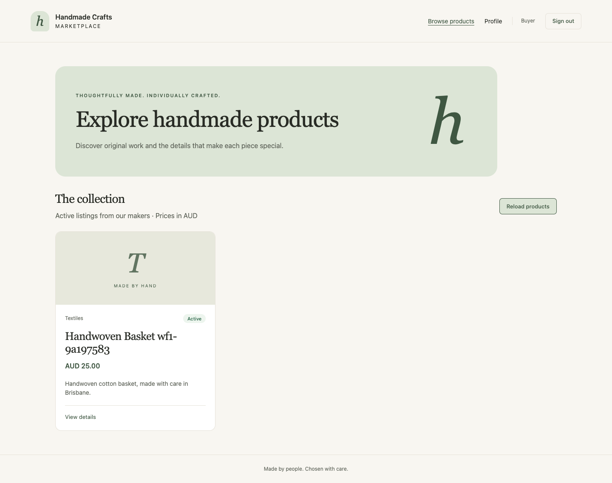
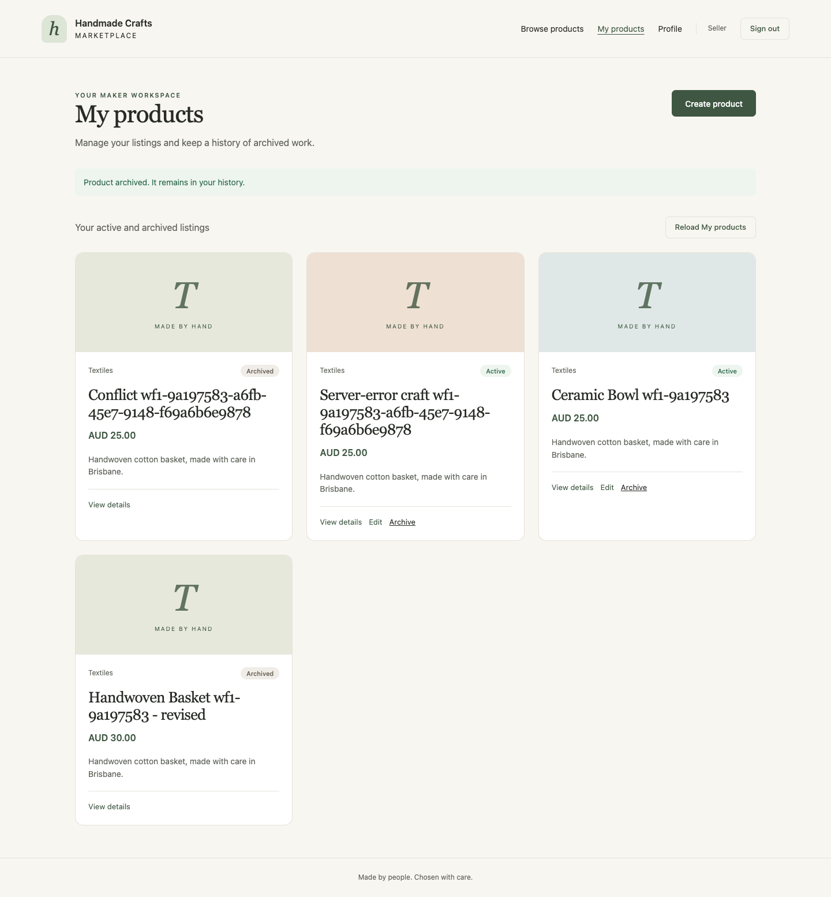

# S09-S10 verification

Date: 6 November 2026, Australia/Brisbane. Baseline: S08 main `fa0b62140bf1e0e089ac90a16a928c7adf707f0c`.

## Recorded results

| Layer | Actual result | Evidence / boundary |
| --- | --- | --- |
| Backend regression | 150 passing | Existing Product/auth code is unchanged. An initial sandbox attempt could not listen on local sockets; the approved rerun passed. |
| Frontend regression | 70 passing in 7 suites | Amount boundaries, request payloads/wrappers, return paths, state cancellation, session changes, mutation locking, forms and uncertain writes. CRA/Jest; no new application test dependency. |
| Production build | Passed | This generates the React build; Express production serving and external EC2 checks remain S11. Existing Browserslist age warnings are retained. |
| Initial browser run | 27/27 | Source `3960ab61a21ccdb9b45060e7a05c4dd31227c0dc`, clean tree. |
| Self-review reproduction | 1/2 including setup | The added UX-5XX case exposed a real handling gap using a real committed Product and an injected HTTP 500. [Before result](evidence/s10-review-before.json); [added verifier case](evidence/s10-review-case.patch). |
| Final real browser run | 28/28 | Source `47a70bebd5810063952c72ba8e6b01950be180e7`, clean tree. [Full result](evidence/s09-browser-results.json). |
| Postman / Newman | 38 requests, 114 assertions; no failures | Source `813d4eaa2f556d11d3cd4dc01ff4440a27493d5e`; [sanitized result](evidence/s09-newman-results.json). Actual Postman Desktop GUI use is not claimed. |

Node: v22.23.2. The browser verifier uses separate Chrome contexts and a real Express process behind the existing CRA proxy. Test data is persisted to the specifically verified `hm_s08_test` database. Each run cleans only its UUID-scoped fixtures; there is no global DB clear. The final browser run removed its remaining two generated users and four products; a third fixture user was deliberately deleted by the real 401 test. The Newman run removed three generated users and one product. Both recorded zero remaining scoped fixtures.

## Workflow and failure coverage

- Seller publishes at AUD 25.00 -> Buyer reads -> owner updates to AUD 30.00 -> Buyer reads the saved update -> owner cancels/confirms archive -> public reads exclude the archived product -> owner retains read-only history.
- Real API/DB assertions verify anonymous 401, Buyer/cross-owner 403, no inserted record on denied creation and full target-record/count equality on denied writes.
- Malformed IDs, missing records, whitelisted fields, invalid prices, immutable owner, read-only archived records and state conflicts are checked.
- The actual backend process was replaced from PID 12579 to PID 12630 in the final browser run. Saved active and archived records remained readable in the appropriate browser sessions.
- Delayed reads, public empty responses, network failures and role-error responses are explicitly identified as controlled/injected cases. Normal workflow operations and persistence use actual API/DB data.
- A deliberately lost browser response after a real POST and a deliberately injected HTTP 500 after a real POST both create exactly one record and offer reconciliation without an automatic duplicate.
- Real 390px/1024px checks found no horizontal overflow; label/Tab and archive cancel/Escape focus behaviour were exercised. This is not a full accessibility audit.

## Review and improvement

[PR #5](https://github.com/camperjx/handmade-crafts-marketplace-ifq636-a1/pull/5) [self-review finding](https://github.com/camperjx/handmade-crafts-marketplace-ifq636-a1/pull/5#issuecomment-6681563199) was recorded before the correction. The reproduction saved one Product then replaced the response with HTTP 500; the UI only said to try again and did not expose the reconciliation link. The before evidence has the original UI source SHA plus a verifier-only working-tree change, preserved as a patch.

[Improvement commit 47a70be](https://github.com/camperjx/handmade-crafts-marketplace-ifq636-a1/commit/47a70bebd5810063952c72ba8e6b01950be180e7) treats HTTP 5xx writes as uncertain, preserves the draft, and offers Check My products. Three 5xx regression cases and a validation distinction were added. UX-5XX passed in the full 28-case rerun. The failure response was deliberately injected; no naturally occurring production failure is claimed.





## Reproduce

Use Node 22, a separate Playwright installation plus installed Chrome, and a separate Newman 6.2.1 installation. Application dependency manifests are unchanged. Set the ignored `backend/.env.s08-test.local` variable `PRODUCT_TEST_MONGO_URI` to the dedicated `hm_s08_test` database; no credential is exported.

Start CRA on 3000 with its existing proxy to 5001. Ensure 5001 is free before these sequential checks; the verifiers refuse to replace an existing listener and stop only their own backend process.

```sh
RUN_PRODUCT_DB_TESTS=1 S09_BROWSER_MODULE=/path/to/playwright \
S09_FRONTEND_URL=http://localhost:3000 \
node frontend/scripts/verify-s09-s10.cjs

RUN_PRODUCT_DB_TESTS=1 S09_NEWMAN_MODULE=/path/to/newman \
node backend/scripts/verify-s09-postman.cjs
```

Optional `S09_CASE_FILTER=SETUP-01,UX-5XX` runs only the specified cases and is explicitly recorded in the JSON. Output defaults to ignored `artifacts/` paths. No raw HAR, populated environment or raw Newman export is saved.

## Remaining boundaries

- Local Product WF1 is delivered; external university EC2 deployment, public URL and production static serving/deep-link handling are S11.
- Order creation, archived-product order rejection and WF2 remain S12 onward. This increment does not complete the whole assignment.
- Active Product edits do not have general optimistic version locking. Session revision prevents account races, not concurrent Product edit conflicts.
- Jira live status was not changed: no Jira tool is connected and the supplied URL was inaccessible to the available web tool. The course workspace contains a per-ticket English update draft.
- Figma playback/sharing/local-backup gaps and Postman Desktop screenshots keep their independent pending status. These browser screenshots are implementation evidence.
- The merged SHA is recorded in the course execution report. Later documentation/evidence commits do not change the tested application runtime; compare `frontend/src`, `backend` runtime and dependency files if main changes.
